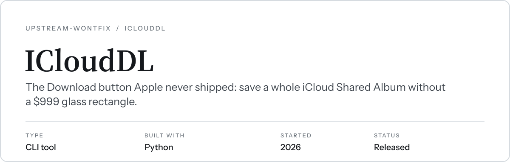

<!-- header:start -->
<div align="center">




[](LICENSE)

[Install](#install) · [Use](#use) · [Heads-up on quality](#heads-up-on-quality)

</div>

<a href="https://haiscale.amolven.com/A1/"></a>

<sub>Full terms: [DISCLAIMER.md](DISCLAIMER.md)</sub>
<!-- header:end -->

Download photos and videos from an iCloud share for those without an Apple device.

Apple built "Shared Albums" so anyone can look at your photos — then made sure anyone *without* a $999 glass rectangle has to right-click and "Save As" one by one like it's a GeoCities page. ICloudDL is the **Download** button they never got around to shipping to the rest of us: point it at your exported cookies, run one command, and the whole shared album lands in a folder — proper file extensions, EXIF intact, JSON sidecars and all.

No Mac, no iPhone, no "just sign in with your Apple ID on your other Apple device."

## Install

```bash
pip install -r requirements.txt     # needs `exiftool` on PATH for sidecars; pillow-heif only for true-HEIC transcode
```

## Use

Export your `www.icloud.com` cookies to a JSON file while signed in (any "cookies.json" browser extension works), then:

```bash
python3 iclouddl.py -cf cookies.json -l                      # list the shared albums you can see
python3 iclouddl.py -cf cookies.json -a "Lake Tahoe" -a 1    # download specific albums (name, index, or GUID)
python3 iclouddl.py -cf cookies.json -A -o ~/Pictures/shared # download them all
```

| Flag | Meaning |
|------|---------|
| `-l, --list` | List shared albums |
| `-a, --album` | Download one album by index / name / GUID (repeatable) |
| `-A, --all` | Download every shared album |
| `-cf, --cookies` | Exported `www.icloud.com.cookies.json` (or `$ICLOUDDL_COOKIES`) |
| `-o, --output` | Output root (one folder per album) |
| `-nv, --novideo` | Skip videos |
| `-f, --force` | Re-download even if already present |
| `-j, --jobs` | Parallel downloads (default 4) |
| `--no-convert` | Keep bytes exactly as served (default: fix extensions, transcode true HEIC) |
| `--no-sidecar` | Don't write JSON sidecars |
| `--manifest` | Also write `album.json` with raw iCloud records |
| `--dry-run` | Show what would download; fetch nothing |

Runs are **idempotent**: each album keeps a `.iclouddl-index.json`, so re-running skips what's already downloaded and only fetches the rest. Drop the connection, run it again, it finishes the job.

## Heads-up on quality

iCloud serves shared-album media as **re-encoded ~1536px copies**, not full-resolution originals — that's a limit of iCloud Photo Sharing itself, not this tool. Capture date and camera/lens/exposure survive on every photo; GPS survives on some (Apple strips it from many shared copies, and videos carry none).

---

Unofficial, AI-assisted, provided as-is. Downloads only shared albums your own account already has access to. Not affiliated with or endorsed by Apple. See [DISCLAIMER.md](DISCLAIMER.md).
